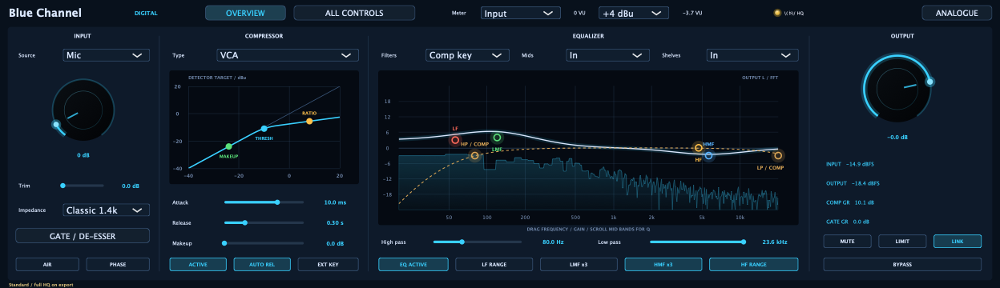
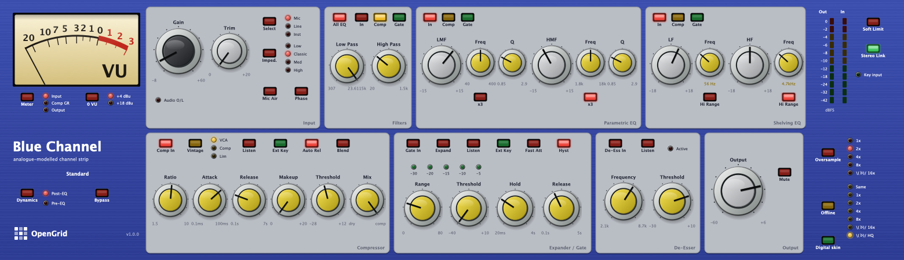
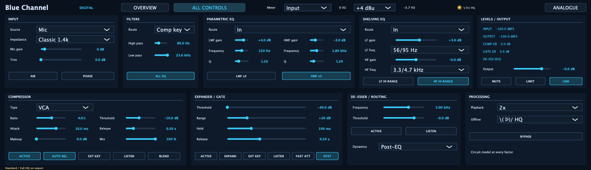

# Blue Channel

**A circuit-modelled channel strip by OpenGrid.** Blue Channel combines a transformer microphone preamp,
line and instrument inputs, filters, four-band EQ, compression, gate/expander, de-esser and output
transformer in one plugin.



| Analogue-style | All Digital controls |
|---|---|
|  |  |

Both interfaces control the same audio model. Digital adds a draggable compressor curve and EQ controls
with an output FFT. HP/LP filters stay editable when routed to a sidechain and dim when switched out.

## Version 1.0

- New instances select **Mic at 0 dB**, calibrated to nominal input-to-output unity with default settings.
- Standard playback has selectable 1x–16x oversampling and a separate offline setting.
- The final **`\( ᐖ)/ HQ`** lamp in **Offline** arms the full component solver. Digital has the same choice
  in its Offline menu on All Controls, with a header indicator. There is no realtime HQ mode.
- Mono/stereo operation, external key inputs, stereo-linked detectors, routing and listen controls.
- The editor starts at 1248 × 360 and remembers resizing. The source build offers optional layout editing.

## Download

**macOS 11 or later, Apple Silicon and Intel:**
[BlueChannel-1.0.0-macos.pkg](https://github.com/MistaMin/BlueChannel/releases/download/v1.0.0/BlueChannel-1.0.0-macos.pkg)

The installer offers **VST3, Audio Unit, CLAP, LV2 and Standalone**, with the guide, screenshots and licence
texts. A portable bundle zip, checksums, build manifest and simulator source are on the
[release page](https://github.com/MistaMin/BlueChannel/releases/tag/v1.0.0). Signing and notarisation results
are recorded there. AAX is not distributed. Windows/Linux source builds and CI packaging are available;
their HQ library packaging and physical-machine acceptance are not validated for this release.

## User guide

See the [User Guide](docs/USER_MANUAL.md), [HQ mode](docs/HQ_MODE.md) and
[1.0 release notes](docs/RELEASE_1.0.0.md).

**Offline HQ is experimental and can be extremely slow.** Begin with a millisecond-scale selection.
A failure mutes export and displays its status; playback remains Standard. Long solves retain probe
history and grow in memory. Full-solve estimates do not turn estimated parts into measured hardware.
Listening acceptance, multi-instance DAW checks and long-render validation remain open. See
[measurements and limits](docs/MEASUREMENTS.md).

## Build

```sh
git clone https://github.com/MistaMin/BlueChannel.git
cd BlueChannel
cmake -S . -B build -G Ninja -DCMAKE_BUILD_TYPE=Release -DBLUECHANNEL_BUILD_AAX=OFF
cmake --build build
ctest --test-dir build --output-on-failure
```

This builds Standard processing without the optional simulator. For full HQ, install a shared ngspice
library/header and use `-DBLUECHANNEL_HQ=ON`. All authored numerical model code is included; no private
hardware source documents are needed. Universal macOS HQ builds use
[the simulator build script](tools/build_hq_simulator_macos.sh). See [Building](docs/BUILDING.md) and
[Release process](docs/RELEASE.md).

## Licence

Blue Channel source code is [MIT licensed](LICENSE); copyright (c) 2026 OpenGrid / Marcos Deida. The official complete binaries are distributed as **freeware** under the publisher's commercial JUCE licence, free of charge for personal or commercial audio production. End users do not need a JUCE developer licence to install or use these downloads. See [official binary terms](BINARY_LICENSE.txt).

**Licensing disclaimer:** JUCE is available under open-source terms (GPLv3 / AGPLv3) or a commercial JUCE licence; it is NOT covered by this project's MIT licence. If you build or redistribute binaries from this source code, you must comply with your own JUCE licence terms (GPL/AGPL or commercial) — the publisher's commercial licence does not transfer to third-party builds. The vendored [GoodLookinUI](third_party/GoodLookinUI) runtime headers retain their MIT licence. Other components retain their respective terms, including the shared simulator's BSD, MIT and LGPL rights. See [Third-party licences](THIRD_PARTY_LICENSES.md) and the included texts.

Original third-party hardware documents, drawings, OCR and research renders are not distributed.
[Source provenance](SOURCE_PROVENANCE.md) records the separation between private inputs and public code.
