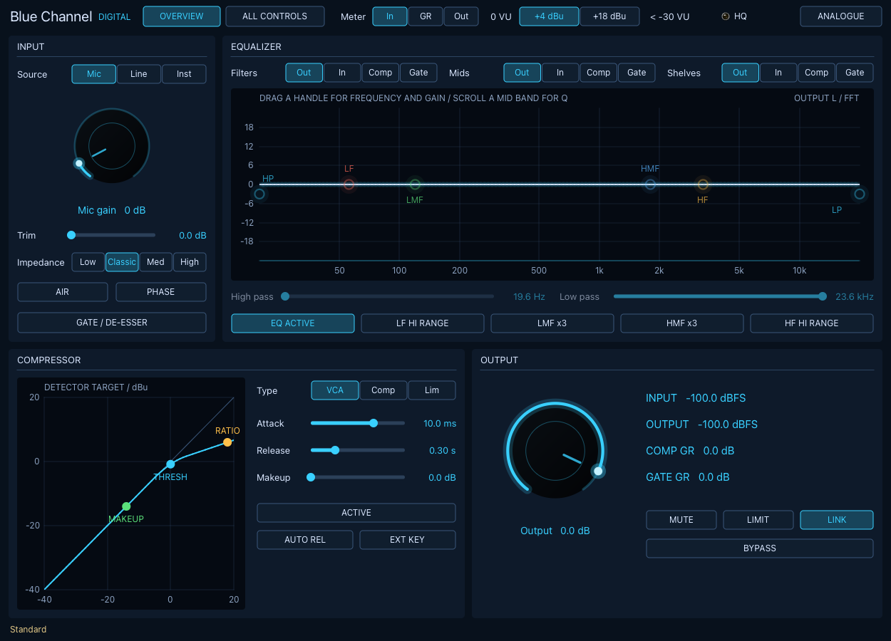
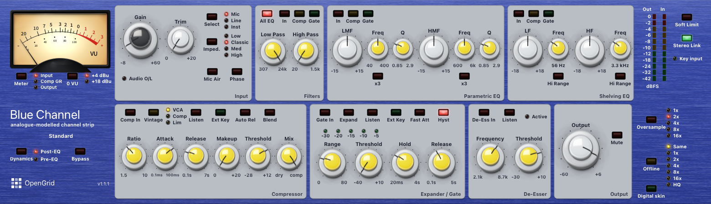
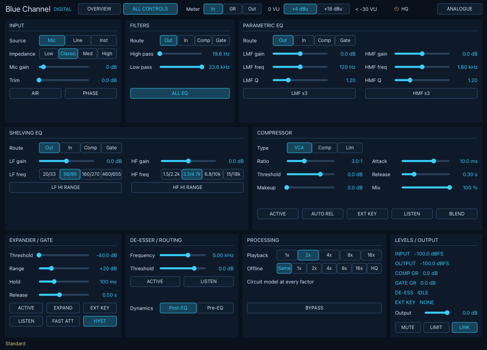

# Blue Channel

**A circuit-modelled channel strip by OpenGrid.** Blue Channel combines a transformer microphone preamp,
line and instrument inputs, filters, four-band EQ, compression, gate/expander, de-esser and output
transformer in one plugin.



| Analogue-style | All Digital controls |
|---|---|
|  |  |

Both interfaces control the same audio model. Digital adds a draggable compressor curve and EQ controls
with an output FFT. HP/LP filters stay editable when routed to a sidechain and dim when switched out.

## Version 1.1.1

- **A project saved with 1.0 now opens with its settings in VST3, Audio Unit and AAX hosts too.** 1.1.0
  read them in CLAP hosts only.
- Fixed: with the Mic input, a loud tone below about 100 Hz could make the output overflow after a few
  seconds and leave the instance silent until it was reset. 1.0.0 and 1.1.0 both did this.
- From OpenPluginSDK: an Audio Unit host that sets a switch between two steps gets the nearest step, and
  edits made in a VST3 host while the plugin is not processing are kept in the project.
- Otherwise the plugin of 1.1.0: the circuit model of 1.0 on OpenPluginSDK, the editor drawn by
  GoodLookin DRI, the same plugin ids and 62 parameters. See the [1.1.1 release notes](docs/RELEASE_1.1.1.md).

## Download

- **macOS 11 or later (Apple Silicon and Intel):** [Blue-Channel-1.1.1-macos.pkg](https://github.com/MistaMin/BlueChannel/releases/download/v1.1.1/Blue-Channel-1.1.1-macos.pkg)
- **Windows 10 or later (x64):** [Blue-Channel-1.1.1-windows-x64-setup.exe](https://github.com/MistaMin/BlueChannel/releases/download/v1.1.1/Blue-Channel-1.1.1-windows-x64-setup.exe)

The macOS installer offers **VST3, Audio Unit, CLAP, LV2 and AAX**, all freeware. It is signed with a
Developer ID and notarised by Apple, and the AAX plug-in is signed with PACE Eden for Pro Tools. The
Windows installer offers **VST3 and CLAP** and is not code signed. Checksums, the manual as a PDF and the
manifest are on the [release page](https://github.com/MistaMin/BlueChannel/releases/tag/v1.1.1).

Not in 1.1: a standalone application, LV2 and AAX on Windows, and Linux. HQ mode is macOS only. The
Windows build was built and tested by machine and has not been opened in a host by a person. For the
missing platforms and formats, [1.0.0](https://github.com/MistaMin/BlueChannel/releases/tag/v1.0.0)
stays available.

## User guide

See the [User Guide](docs/USER_MANUAL.md), [HQ mode](docs/HQ_MODE.md), the
[changelog](CHANGELOG.md) and the [1.1.1 release notes](docs/RELEASE_1.1.1.md)
([1.1.0](docs/RELEASE_1.1.0.md), [1.0](docs/RELEASE_1.0.0.md)).

**Offline HQ is experimental and can be extremely slow.** Begin with a millisecond-scale selection.
A failure mutes export and displays its status; playback remains Standard. Long solves retain probe
history and grow in memory. Full-solve estimates do not turn estimated parts into measured hardware.
Listening acceptance, multi-instance DAW checks and long-render validation remain open. See
[measurements and limits](docs/MEASUREMENTS.md).

## Build from source

Version 1.1 is the Rust crate in [`plugin/`](plugin/README.md). It needs Rust and a C++20 compiler. Cargo
fetches OpenPluginSDK at the revision the crate names; building the bundles needs a checkout of the same
revision, and the VST3, Audio Unit and AAX formats also need their SDKs.

```sh
git clone https://github.com/MistaMin/BlueChannel.git
cd BlueChannel/plugin
OPENPLUGIN_SDK=/path/to/OpenPluginSDK scripts/build.sh --formats clap,lv2   # bundles in plugin/dist
cargo test
```

`plugin/README.md` describes the layout, the tests and the options, including HQ mode (`--hq`, which
needs a shared ngspice library; see [the simulator build script](tools/build_hq_simulator_macos.sh)).
All authored numerical model code is included; no private hardware source documents are needed.

The JUCE build that 1.0 was made from is at tag `v1.0.0`. The model it shares with 1.1 stays in
`Source/Model`, `Source/Circuit`, `Source/DSP` and `Source/Dynamics`, with its own tests
([Building](docs/BUILDING.md)).

## Licence

Blue Channel source code is [MIT licensed](LICENSE); copyright (c) 2026 Marcos Quirino Deida. The official binaries are distributed as **freeware**, free of charge for personal or commercial audio production. See [official binary terms](BINARY_LICENSE.txt).

Version 1.1 binaries are built with OpenPluginSDK and GoodLookin DRI and contain no JUCE code. The 1.0 source at tag `v1.0.0` uses JUCE, which is available under AGPLv3 or a commercial JUCE licence; anyone building or redistributing it must comply with their own JUCE licence terms. Other components retain their respective terms, including the shared simulator's BSD, MIT and LGPL rights. See [Third-party licences](THIRD_PARTY_LICENSES.md) and the included texts.

VST is a trademark of Steinberg Media Technologies GmbH. Audio Units is a trademark of Apple Inc. AAX and Pro Tools are trademarks of Avid Technology, Inc.

Original third-party hardware documents, drawings, OCR and research renders are not distributed.
[Source provenance](SOURCE_PROVENANCE.md) records the separation between private inputs and public code.
