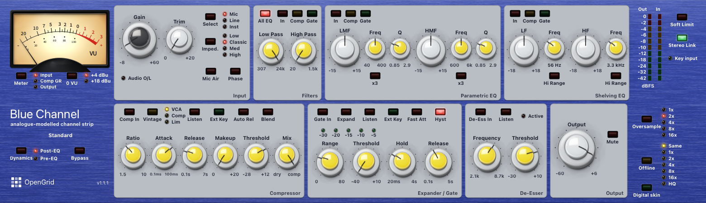
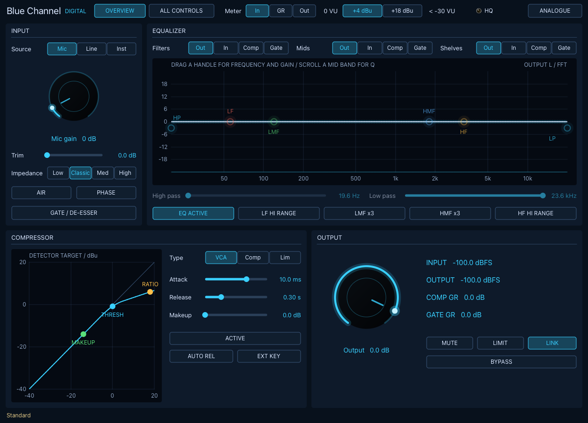
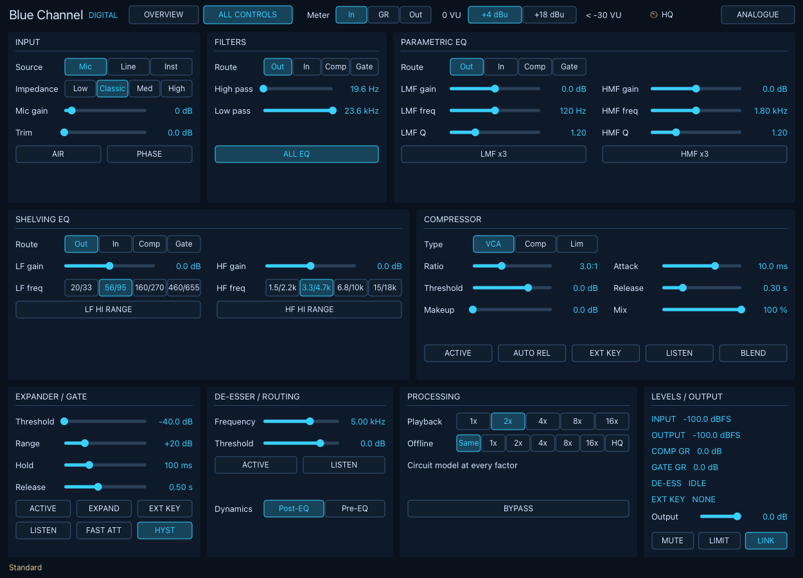

# Blue Channel 1.1

Blue Channel 1.1 is the same channel strip on a new foundation. The plugin is rebuilt on OpenPluginSDK
with its editor drawn by GoodLookin DRI. The signal path is the C++ circuit model of 1.0, unchanged: on
the same input the two versions produce the same output to within 1e-6 of full scale (-120 dBFS). To a host
it is the same plugin, with the plugin ids, the 62 parameters, their ids and their order of 1.0.

## What is new

- The Digital skin has a new layout at 1250 × 900: rows of keys for choices, sliders with their values
  beside them, and the compressor curve, EQ graph and output spectrum of 1.0.
- The analogue skin keeps the panel of 1.0 at 1560 × 450, with lit knobs and sharper lettering.
- Each skin resizes in its own shape, and the size is saved with the project.
- The Digital skin's numbers for input, output and gain reduction change every 1.5 seconds and show the
  highest reading of that time. The bars and the VU needle still move continuously.
- Hosts see parameters in their own units (dB, Hz, positions) and receive a 5 second tail.

## Formats and requirements

| Platform | Formats | File |
|---|---|---|
| macOS 11 or later, Apple Silicon and Intel | VST3, Audio Unit, CLAP, LV2, AAX | `Blue-Channel-1.1.0-macos.pkg` |
| Windows 10 or later, x64 | VST3, CLAP | `Blue-Channel-1.1.0-windows-x64-setup.exe` |

The macOS installer is signed with a Developer ID and notarised by Apple, and its AAX plug-in is signed
with PACE Eden for Pro Tools. The Windows installer is not code signed. Run the installer and rescan
plug-ins in the host. Installing 1.1 replaces 1.0 in the formats it has.

Not in this version: a standalone application, LV2 on Windows, AAX on Windows, and Linux. Blue Channel
1.0.0 stays available for those.

## Read before updating from 1.0

- **VST3, Audio Unit and AAX: a project saved with 1.0 opens with Blue Channel at its default settings.**
  1.1 does not read the settings 1.0 saved in those formats. CLAP projects open with their settings. If
  you have projects that use 1.0 in a VST3, Audio Unit or AAX host, keep 1.0 until they are finished, or
  write the settings down first.
- Automation of continuous controls that a CLAP host recorded with 1.0 plays back at other values,
  because 1.0 showed every parameter as 0 to 1. Automation of switches is unaffected.
- The "Program" parameter of 1.0 is gone. The six factory programs are offered through the plugin's
  preset interface, which hosts do not show in their preset menus yet.
- The Output control's travel in a host's own parameter view is linear in dB; 1.0 skewed it.
- Audio is processed in 32-bit float buffers; the model computes in double precision as before.

## What was checked

- macOS, Apple Silicon: the plugin's own tests (parameters, state, the SDK's conformance kit, offline
  rendering, HQ Mode) and a null test of the VST3, Audio Unit and CLAP against the installed 1.0.0.
- Apple's `auval` passes for the Audio Unit.
- A scripted host suite in REAPER on macOS with the VST3: load, every parameter changes the sound, save
  and reopen, and the editor opening and closing. Its check that every control is visible ran on a
  screen narrower than the editor, which cut the right-hand controls off; see the limits below.
- Avid's AAX Validator on the unsigned AAX: every test that runs without HDX hardware passes.
- Windows: the plugin's tests and the build's own checks (64-bit, no Visual C++ runtime dependency,
  format entry points) on a hosted Windows machine.

## Known limits

- Not checked by a person in a host: Pro Tools, Logic, and every Windows host. The Windows build has
  been built and tested by machine only; nobody has opened its editor.
- The editor opens no larger than the main screen has room for. A host that opens it on a second,
  narrower screen can still cut it off; drag the window's corner to make it smaller.
- The Intel half of the macOS build was built and not run.
- In an Audio Unit host a switch set to a value between its positions by automation can be saved as that
  in-between value; it reads back as the nearer position.
- HQ Mode (macOS only) solves mono instances. On a stereo track the solve fails and the export is muted
  with "HQ failed". 1.0 fails in the same way; it is the same solver.
- Full HQ is experimental and very slow. A failed HQ export is muted and never replaced by Standard
  audio. See [HQ mode](https://github.com/MistaMin/BlueChannel/blob/main/docs/HQ_MODE.md).
- Listening acceptance and long sessions with many instances remain open, as for 1.0.

## Files

- `Blue-Channel-1.1.0-macos.pkg` and its `.sha256`
- `Blue-Channel-1.1.0-windows-x64-setup.exe` and its `.sha256`
- `Blue-Channel-User-Manual.pdf`
- `opengrid-manifest.json`
- `BlueChannel-1.0.0-ngspice-source.tar.gz`: the source of the simulator library the macOS build loads
  for HQ Mode, unchanged since 1.0.0

Source is MIT licensed. The official binaries are freeware (`BINARY_LICENSE.txt`); the components they
link keep their own licences (`THIRD_PARTY_LICENSES.md`).

