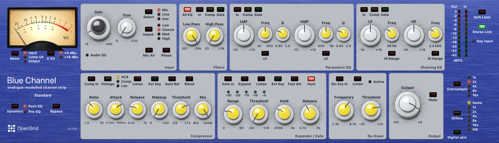
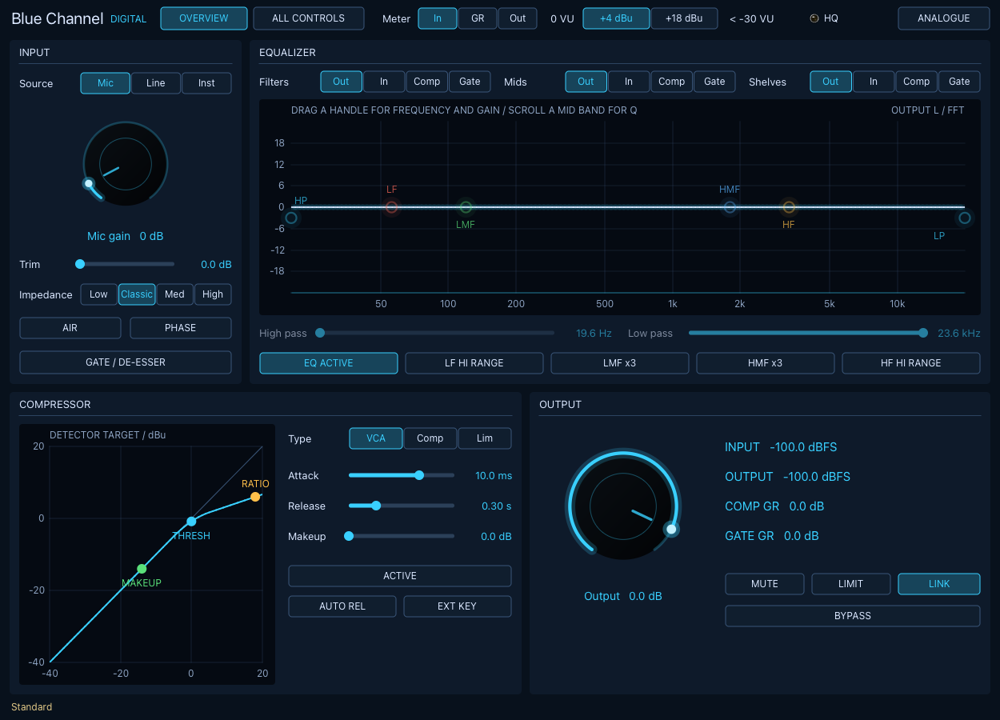
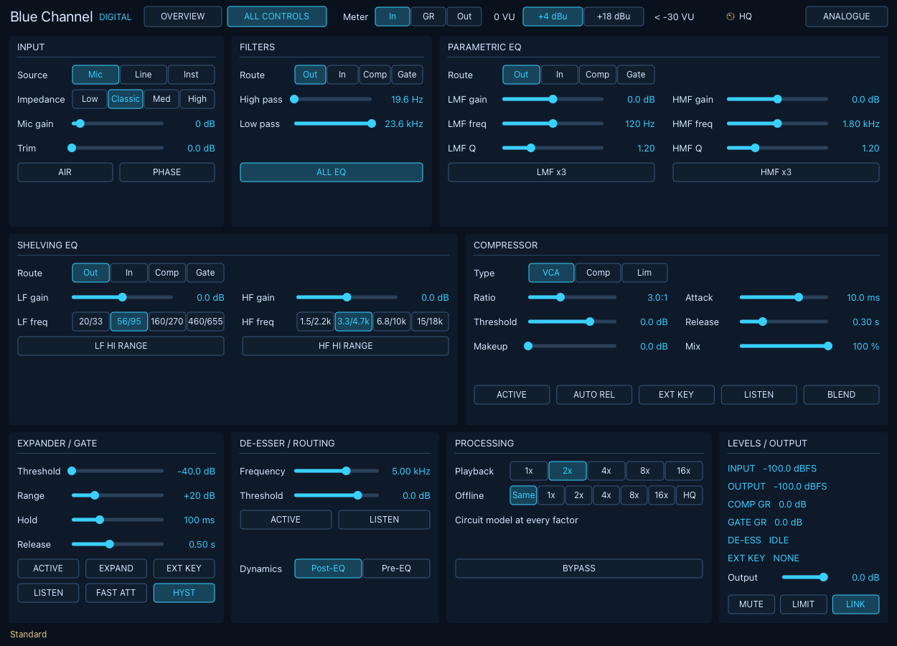

# Blue Channel 1.1 user guide

Blue Channel is an analogue-modelled channel strip: a transformer microphone preamp with line and instrument
inputs, high- and low-pass filters, shelving and parametric EQ, a VCA compressor with two optical "vintage"
modes, an expander/gate, an optical de-esser and an optical soft limiter. The audio runs through a model of
the circuit at all times; there is no clean digital mode.

*Editor, analogue skin. The Digital skin key opens a dedicated digital layout with a draggable compressor curve, EQ graph over a live output-left FFT spectrum, and an All Controls page for the full parameter set; it changes
nothing in the sound.*

*Digital overview: compressor handles, EQ response, output FFT and sidechain filter curve.*

*All Controls: the complete parameter set. The Overview and All Controls tabs stay visible on both pages.*

## The editor

The analogue skin opens at 1560 x 450 and the Digital skin at 1250 x 900, or smaller where the main
screen has no room for that. Each skin keeps its own shape:
drag the window's corner to make it smaller or larger, and the size is saved with the project. Turn a
knob by dragging it up or down, hold Shift for fine steps, and double-click it for its default. While
the pointer is over a knob a small plate shows its value.

In the Digital skin a choice is a row of keys, one lit, and a continuous control is a slider with its
value beside it. The numbers for input, output and gain reduction change every 1.5 seconds and show the
highest reading of that time, so they can be read; the bars and the VU needle move continuously.

## Signal flow

`Mic / Line / Inst -> Trim, Phase -> Filters -> Shelving -> Parametric -> Compressor/Gate -> De-esser -> Output level -> Soft limiter -> Output transformer`

**Dynamics** moves the compressor, gate and de-esser before the EQ (Pre-EQ). **Bypass** takes the EQ,
dynamics and limiter out; the input stage and output stage stay in, as on hardware.

## Levels

Blue Channel treats a full-scale sine (0 dBFS) as +22 dBu, so -18 dBFS is +4 dBu. With the Line input at
0 dB, trim at 0 and Output at 0 dB the plugin is unity gain. Push the input or trim and the circuit's own
headroom (about +28 dBu at the line input) and transformer character come into play.

The **Mic** input expects microphone-level signals: on line-level tracks use the low gain positions
(-8 to +11 dB). It assumes a 150 ohm source, so Impedance and Mic Air behave as they would with a real
microphone.

## Input

| Control | What it does |
|---|---|
| Select | Mic, Line or Inst. |
| Gain | Mic: 12 positions, -8 to +60 dB. Line: -18 to +18 dB in 6 dB steps. Inactive for Inst. |
| Trim | 0 to +20 dB after the gain switch. For Inst it is the only gain control (+13 to +46 dB). |
| Phase | Inverts polarity. |
| Imped. | Mic input impedance: Low (600), Classic (1.4k), Medium (2.4k), High (6.8k). Higher settings give a little more level and a flatter, brighter microphone response. |
| Mic Air | Lightens the transformer's high-frequency loading for a gentle lift above about 5 kHz. |
| Audio O/L | Lights 6 dB before an internal stage clips. |

The microphone transformer adds low-frequency harmonics at high levels (about 0.2 % at 50 Hz and 0 dBu);
the instrument input saturates musically when driven, mostly second harmonic.

## Equaliser

Each EQ section has three keys: **In** (in the audio path), **Comp** (filters the compressor key instead
of the audio) and **Gate** (filters the gate key instead). Press a lit key again to turn the section off.
**All EQ** takes every section out of the audio path at once for A/B comparison; sections routed to a key
keep working.

| Section | Controls |
|---|---|
| Filters | High Pass 20 Hz to 1.5 kHz and Low Pass 300 Hz to 23 kHz, both 18 dB/octave. Together they make a band-pass, useful as a compressor or gate key filter. |
| Parametric | LMF 40 to 400 Hz (120 Hz to 1.2 kHz with x3) and HMF 600 Hz to 6 kHz (1.8 to 18 kHz with x3); gain +/-15 dB; Q 0.85 (wide) to 2.9 (narrow). |
| Shelving | LF 20, 56, 160, 460 Hz (Hi Range: 33, 95, 270, 655 Hz) and HF 1.5, 3.3, 6.8, 15 kHz (Hi Range: 2.2, 4.7, 10, 18 kHz); gain +/-18 dB. |

## Compressor

| Control | What it does |
|---|---|
| Comp In | Engages the compressor. |
| Vintage | Steps VCA -> Vintage Comp -> Vintage Lim. VCA is the discrete class-A compressor. The vintage modes are optical: fixed timing, soft knee (Comp) or hard knee with higher ratios (Lim). Attack, Release, Auto Rel and Ext Key do not apply to them. |
| Ratio | 1.5:1 to 10:1 (vintage Comp 1.5 to 5, Lim 5 to 20). |
| Threshold | -28 to +12 dB, on the same scale as the signal level in dBu (+4 dBu = -18 dBFS). |
| Attack, Release | 0.1 to 100 ms, 0.1 to 7 s. |
| Auto Rel | Program-dependent release: quick after short peaks, slow after sustained compression. |
| Makeup | 0 to +20 dB. |
| Ext Key | The plugin's sidechain input drives the compressor. |
| Blend, Mix | Parallel compression: Mix from dry to fully compressed. |
| Listen | Hear the compressor key (after any EQ routed to Comp). |

The VU meter can show compressor gain reduction (Meter: Comp GR).

## Expander / gate

| Control | What it does |
|---|---|
| Gate In, Expand | Gate, or a gentler 1:2 downward expander. |
| Threshold | -40 to +10 dB. |
| Range | How far the gate closes, 0 to 80 dB. |
| Hold, Release | 20 ms to 4 s hold before releasing over 0.1 to 5 s. |
| Fast Att | Faster opening for transients. |
| Hyst | Closes 10 dB below the opening threshold instead of 2 dB, to stop chattering. |
| Ext Key, Listen | Sidechain input as key; hear the key. |

The LED row shows gate attenuation.

## De-esser

Pick the sibilance with **Frequency** (2.1 to 8.7 kHz), use **Listen** to hear the band, then set
**Threshold**: above it the band is reduced at about 2:1. **Active** glows with the optical cell.

## Output

**Output** sets the level, -60 to +6.6 dB. **Mute** silences the output. **Soft Limit** engages the optical
three-band limiter: progressively harder limiting from -6 dBFS, with a ceiling near -2.7 dBFS.

## Meters

The VU shows input level, compressor gain reduction or output level, with 0 VU at +4 dBu or +18 dBu. The
LED bars show output and input peaks in dBFS.

## Stereo and sidechain

On stereo tracks each channel has its own circuit. **Stereo Link** makes the compressor and gate respond to
the louder channel; the de-esser is never linked. A mono or stereo sidechain feeds Ext Key; when no
sidechain is connected, Ext Key falls back to the internal signal. The **Key input** lamp shows whether the
host is sending a sidechain.

## Oversampling

**Oversample** sets the internal rate: 1x, 2x (default), 4x, 8x or 16x (a host's own parameter list
calls it "16x Derp mode", for when the computer is fast and nobody is watching). **Offline** chooses a separate factor used only when the host
renders offline; *Same* uses the playback setting. Blue Channel reports no latency at any setting.

## Programs

Init, Vocal, Drum Bus, Bass DI, Gated Toms, Mix Polish. Programs set the sound controls only. In 1.1
they are offered to the host through the plugin's preset interface; a host that showed them as a
"Program" parameter in 1.0 no longer has that parameter.

### Digital graph controls

Drag the compressor's threshold, ratio and makeup handles to edit the same parameters as the
main panel. The curve shows the detector's static target, including its fixed knee; it does not
show attack/release history or the gain cell's distortion.

Drag an EQ band's node horizontally for frequency and vertically for gain. Scroll over a mid
band to change Q. Shelf frequencies follow their discrete switch positions and selected range.
HP and LP handles move horizontally. The white curve shows the small-signal analogue EQ
response in the audio path; the FFT behind it shows the left output channel from -100 to 0 dBFS.
An out-of-path band's handle is dimmed. Filters assigned to a compressor or gate sidechain
remain editable and show an amber dashed response with their destination; they do not
contribute to the white audio curve. Range switches and routing remain independent of dragging.

Use **All Controls** for all parameters, including gate, de-esser, blend, listening and oversampling,
and **Overview** to return to the graphs. **Analogue** returns to the main panel.

## HQ mode (macOS)

Select the final **HQ** lamp in the analogue **Offline** selector to arm the full component solver
for non-realtime export. Digital has the same HQ key in its Offline row on All Controls, with a
header indicator lamp. Selecting a normal Offline factor disarms HQ. Playback
uses Standard. Full HQ can be vastly slower than real time; try a short selection first. A failed solve
mutes export and marks it failed. HQ solves mono instances: on a stereo track the solve fails and the
export is muted with "HQ failed". The Windows build has no HQ mode. See [HQ mode](HQ_MODE.md) for scope
and limits.

New instances and Init select the Mic preamp at **0 dB**, with trim and output at zero. This is nominal
unity at 1 kHz with the default Classic input impedance and assumed 150-ohm source. The old near-unity
mic gain detent now uses a software calibration to reach zero; all other gain positions remain available.
The output transformer is included in both processing paths. Standard uses an ideal output driver;
Offline HQ solves the nonlinear core with the finite driver and feedback. Feedback can suppress core
colour, so the model does not promise obvious transformer distortion on line input.

## Projects made with 1.0

Version 1.1 is the same plugin to a host: the same plugin ids and the same 62 parameters with the same
ids, in the same order. What differs:

- Parameters are shown to the host in their own units (dB, Hz, positions); 1.0 showed every one as 0 to 1.
  Automation of switches plays back as before. Automation of continuous controls that a CLAP host recorded
  with 1.0 plays back at other values and has to be redrawn.
- A project saved with 1.0 opens with its settings in a CLAP host. **In VST3, Audio Unit and AAX hosts the
  settings saved by 1.0 are not read: the plugin opens at its defaults.** Keep 1.0 for those projects, or
  note the settings before updating.
- A change of a parameter inside an audio block takes effect at its exact position, where 1.0 applied it
  from the start of the block.
- A 5 second tail is reported to the host (1.0 reported none), so a host that stops processing silent
  tracks waits for the model to ring out.

## Formats and licensing

- **macOS 11 or later (Apple Silicon and Intel):** VST3, Audio Unit, CLAP, LV2 and AAX.
- **Windows 10 or later (x64):** VST3 and CLAP.
- A standalone application is built from source and is not in the installers.
- **Licensing:** Blue Channel source code is MIT licensed. The official plugin binaries, including the macOS AAX plugin, are distributed as **freeware**, free of charge for personal or commercial audio production.
- **Third-party attribution:** The AAX plugin is digitally signed with PACE Eden for Pro Tools compatibility. See [BINARY_LICENSE.txt](../BINARY_LICENSE.txt) and [THIRD_PARTY_LICENSES.md](../THIRD_PARTY_LICENSES.md).
